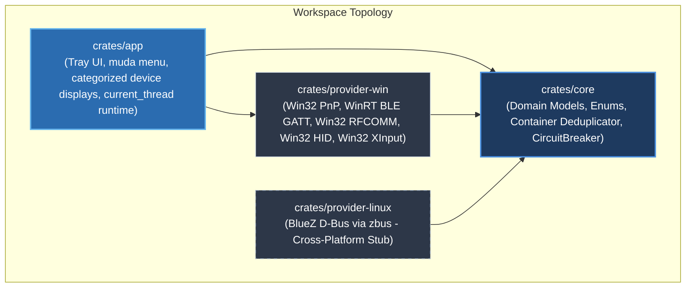
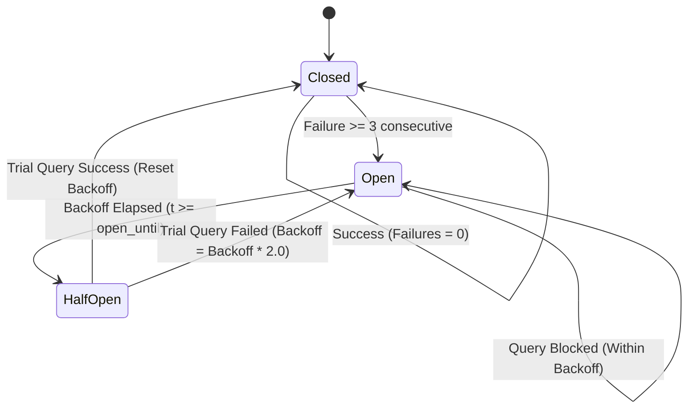
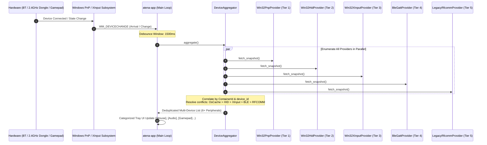

# Atena-Battery: System Architecture Specification

**Document ID:** `ARCH-02-UNIVERSAL-WIRELESS-DESIGN`  
**Author:** System Architect (`02-system-architect`)  
**Target:** Implementation Phase (`03-rust-systems-engineer`)  
**Status:** Approved / Definitive Architecture  
**Upstream Specification:** [docs/specs/feature-parity.md](file:///d:/DotNet/Atena-Battery/docs/specs/feature-parity.md)  
**Gate Status:** Gate 1 Sign-Off Document (Universal Wireless Update)  

---

## 1. Architectural Invariants & Philosophy

The architecture of `Atena-Battery` is engineered as a high-performance, memory-safe, ultra-lightweight systems application. Originally designed for Bluetooth Classic and BLE, it is expanded into a **Universal Wireless Device Battery Monitor** capable of seamlessly monitoring Bluetooth Classic, Bluetooth Low Energy (BLE), 2.4GHz proprietary USB-dongle wireless peripherals (mice, keyboards, headsets), and wireless gamepads (Xbox/XInput) — handling 6+ concurrent devices simultaneously.

```
┌─────────────────────────────────────────────────────────────────────────────┐
│                          ARCHITECTURAL INVARIANTS                           │
│                                                                             │
│  1. ZERO CHILD PROCESSES: No invocation of powershell.exe, cmd.exe, or WMI  │
│     processes. All hardware data is queried directly via Win32 C-bindings.  │
│  2. ZERO OS LEAKAGE IN CORE: `crates/core` contains pure domain logic,      │
│     traits, and state machines with zero dependencies on OS APIs.           │
│  3. UNIVERSAL WIRELESS COMPATIBILITY: Handles Bluetooth (Classic & BLE),    │
│     2.4GHz proprietary USB dongles (HID), and wireless Gamepads (XInput).  │
│  4. SINGLE-THREADED CONCURRENCY: Uses `tokio` (current_thread) to eliminate │
│     thread context-switching overhead and guarantee < 5 MB RAM working set. │
│  5. CONTAINER-BASED DEDUPLICATION: Unifies composite devices sharing a      │
│     Windows `ContainerId` across Bluetooth and HID interfaces without dupes.│
│  6. FAIL-SAFE ISOLATION: A failing or hanging device must never freeze UI   │
│     or block healthy devices; enforced via per-device Circuit Breaker.      │
│  7. EVENT-DRIVEN EFFICIENCY: Zero continuous tight polling loops; driven    │
│     by OS PnP notifications with debounced adaptive hardware queries.       │
└─────────────────────────────────────────────────────────────────────────────┘
```

---

## 2. Cargo Workspace Topology

The repository is structured as a multi-crate Cargo workspace separating platform-independent logic, platform-specific hardware drivers, and the desktop presentation layer.



### 2.1 Crate Roles & Boundaries

| Crate | Responsibilities | Target Restrictions | Key Dependencies |
| :--- | :--- | :--- | :--- |
| **`crates/core`** | Domain types (`BatteryInfo`, `ConnectionType`, `DeviceCategory`, `BatterySource`), async `BatteryProvider` trait, `DeviceAggregator` priority & `ContainerId` engine, per-device `CircuitBreaker`. | Platform-independent. **Zero Windows/Linux FFI**. Compiles on all targets. | `async-trait = "0.1"`, `tokio = { version = "1", features = ["sync"] }`, `serde` |
| **`crates/provider-win`** | Windows hardware interrogation: SetupAPI / CfgMgr32 PnP enumeration, Registry fallback, WinRT BLE GATT client, Win32 RFCOMM AT socket engine, Win32 HID Battery Reports (`Usage Page 0x06` & `0x84/0x85`), Win32 XInput Gamepad Battery queries. | Windows only: `cfg(target_os = "windows")`. | `windows = { version = "0.58", features = [...] }`, `atena-core` |
| **`crates/provider-linux`** | Linux hardware interrogation stub. BlueZ D-Bus client connecting to `org.bluez.Battery1`. Ready for future cross-platform deployment. | Linux only: `cfg(target_os = "linux")`. | `zbus = "4"`, `atena-core` |
| **`crates/app`** | Application binary entrypoint. Win32 message pump, System Tray Icon, categorized Muda context menu, single-thread Tokio runtime. | Windows executable (`windows_subsystem = "windows"`). | `atena-core`, `atena-provider-win`, `tokio`, `tray-icon`, `muda` |

### 2.2 Root Cargo Configuration (`Cargo.toml`)

```toml
[workspace]
resolver = "2"
members = [
    "crates/core",
    "crates/provider-win",
    "crates/provider-linux",
    "crates/app",
]

[workspace.package]
version = "0.1.0"
edition = "2021"
authors = ["Atena Battery Contributors"]
license = "MIT"

[profile.release]
opt-level = "z"         # Optimize for minimal binary footprint
lto = true              # Link-Time Optimization across all crates
codegen-units = 1       # Maximum dead-code elimination & inlining
strip = true            # Strip symbols, debuginfo, and section headers
panic = "abort"         # Eliminate stack-unwinding machinery
```

---

## 3. Domain Model & Trait Specifications (`crates/core`)

All core data structures enforce memory locality, copy semantics where possible, and strict bounds validation without any platform-specific dependencies.

### 3.1 Data Structures (`model.rs`)

```rust
use std::fmt;
use std::time::SystemTime;

/// Canonical 48-bit Bluetooth MAC Address (EUI-48 format).
#[derive(Debug, Clone, PartialEq, Eq, Hash, PartialOrd, Ord)]
pub struct MacAddress(pub [u8; 6]);

impl MacAddress {
    pub fn parse(s: &str) -> Result<Self, &'static str> {
        let cleaned: String = s.chars().filter(|c| c.is_ascii_hexdigit()).collect();
        if cleaned.len() != 12 {
            return Err("Invalid MAC address length");
        }
        let mut bytes = [0u8; 6];
        for i in 0..6 {
            bytes[i] = u8::from_str_radix(&cleaned[i * 2..i * 2 + 2], 16)
                .map_err(|_| "Hex parsing error")?;
        }
        Ok(Self(bytes))
    }

    pub fn to_canonical_string(&self) -> String {
        format!(
            "{:02X}:{:02X}:{:02X}:{:02X}:{:02X}:{:02X}",
            self.0[0], self.0[1], self.0[2], self.0[3], self.0[4], self.0[5]
        )
    }
}

impl fmt::Display for MacAddress {
    fn fmt(&self, f: &mut fmt::Formatter<'_>) -> fmt::Result {
        write!(f, "{}", self.to_canonical_string())
    }
}

/// Physical transport or connection mechanism used by the peripheral.
#[derive(Debug, Clone, Copy, PartialEq, Eq, Hash, Serialize, Deserialize)]
pub enum ConnectionType {
    /// Bluetooth Classic (BR/EDR, RFCOMM, Hands-Free Profile).
    BluetoothClassic,
    /// Bluetooth Low Energy (GATT Battery Service 0x180F).
    BluetoothLE,
    /// 2.4GHz proprietary USB-dongle wireless peripheral (HID reports).
    Wireless24Ghz,
    /// Direct wireless gamepad controller (e.g. Xbox Wireless Controller via XInput).
    Gamepad,
    /// Other / unrecognized wireless or wired connection.
    Other,
}

impl fmt::Display for ConnectionType {
    fn fmt(&self, f: &mut fmt::Formatter<'_>) -> fmt::Result {
        match self {
            Self::BluetoothClassic => write!(f, "Bluetooth Classic"),
            Self::BluetoothLE => write!(f, "Bluetooth LE"),
            Self::Wireless24Ghz => write!(f, "2.4GHz Wireless"),
            Self::Gamepad => write!(f, "Gamepad (XInput)"),
            Self::Other => write!(f, "Other"),
        }
    }
}

/// High-level device peripheral classification for tray presentation and iconography.
#[derive(Debug, Clone, Copy, PartialEq, Eq, Hash, PartialOrd, Ord, Serialize, Deserialize)]
pub enum DeviceCategory {
    Audio,
    Mouse,
    Keyboard,
    Gamepad,
    Peripheral,
}

impl DeviceCategory {
    /// Returns the standard display icon/emoji for Tray UI listings.
    pub const fn icon(&self) -> &'static str {
        match self {
            Self::Audio => "🎧",
            Self::Mouse => "🖱️",
            Self::Keyboard => "⌨️",
            Self::Gamepad => "🎮",
            Self::Peripheral => "🔋",
        }
    }

    /// Returns the text badge prefix.
    pub const fn tag(&self) -> &'static str {
        match self {
            Self::Audio => "[Audio]",
            Self::Mouse => "[Mouse]",
            Self::Keyboard => "[Keyboard]",
            Self::Gamepad => "[Gamepad]",
            Self::Peripheral => "[Peripheral]",
        }
    }
}

impl fmt::Display for DeviceCategory {
    fn fmt(&self, f: &mut fmt::Formatter<'_>) -> fmt::Result {
        write!(f, "{}", self.tag())
    }
}

/// Enumeration of battery query providers ordered by structural preference.
///
/// Priority hierarchy:
/// `OsCache` (5) > `HidStandard` (4) > `XInput` (3) > `BleGatt` (2) > `Rfcomm` (1).
#[derive(Debug, Clone, Copy, PartialEq, Eq, Hash, Serialize, Deserialize)]
pub enum BatterySource {
    /// Tier 1: Operating System cached battery value (zero radio transmission).
    OsCache,
    /// Tier 2: Standard Human Interface Device (HID) battery report (Usage Page 0x06 / 0x84/0x85).
    HidStandard,
    /// Tier 3: Xbox Wireless Gamepad querying via XInput.
    XInput,
    /// Tier 4: Direct Bluetooth Low Energy GATT Battery Service (0x180F).
    BleGatt,
    /// Tier 5: Classic Bluetooth RFCOMM / Hands-Free Profile AT commands.
    Rfcomm,
}

impl BatterySource {
    /// Returns the numerical priority for conflict resolution.
    #[inline]
    pub const fn priority(&self) -> u8 {
        match self {
            Self::OsCache => 5,
            Self::HidStandard => 4,
            Self::XInput => 3,
            Self::BleGatt => 2,
            Self::Rfcomm => 1,
        }
    }
}

impl PartialOrd for BatterySource {
    fn partial_cmp(&self, other: &Self) -> Option<std::cmp::Ordering> {
        Some(self.cmp(other))
    }
}

impl Ord for BatterySource {
    fn cmp(&self, other: &Self) -> std::cmp::Ordering {
        self.priority().cmp(&other.priority())
    }
}

impl fmt::Display for BatterySource {
    fn fmt(&self, f: &mut fmt::Formatter<'_>) -> fmt::Result {
        match self {
            Self::OsCache => write!(f, "OsCache"),
            Self::HidStandard => write!(f, "HID"),
            Self::XInput => write!(f, "XInput"),
            Self::BleGatt => write!(f, "BleGatt"),
            Self::Rfcomm => write!(f, "Rfcomm"),
        }
    }
}

/// Authoritative battery and status snapshot for any wireless peripheral.
#[derive(Debug, Clone, PartialEq, Eq, Serialize, Deserialize)]
pub struct BatteryInfo {
    /// Unified identifier: MAC for Bluetooth, ContainerId or VID:PID:Serial for HID, XInputIndex for gamepads.
    pub device_id: String,
    pub name: String,
    pub level: u8,
    pub is_connected: bool,
    pub source: BatterySource,
    pub connection_type: ConnectionType,
    pub category: DeviceCategory,
    /// Windows Device ContainerId (UUID) for hardware grouping and cross-provider deduplication.
    pub container_id: Option<String>,
    pub last_updated: SystemTime,
}

impl BatteryInfo {
    pub fn new(
        device_id: impl Into<String>,
        name: impl Into<String>,
        level: u8,
        is_connected: bool,
        source: BatterySource,
        connection_type: ConnectionType,
        category: DeviceCategory,
        last_updated: SystemTime,
    ) -> Self {
        Self {
            device_id: device_id.into(),
            name: name.into(),
            level: level.min(100),
            is_connected,
            source,
            connection_type,
            category,
            container_id: None,
            last_updated,
        }
    }

    pub fn with_container_id(mut self, container_id: impl Into<String>) -> Self {
        self.container_id = Some(container_id.into());
        self
    }

    /// Backward compatibility helper returning the MAC address if the device is a Bluetooth peripheral.
    pub fn mac_address(&self) -> Option<&str> {
        match self.connection_type {
            ConnectionType::BluetoothClassic | ConnectionType::BluetoothLE => Some(&self.device_id),
            _ => None,
        }
    }
}

/// Real-time hardware lifecycle events.
#[derive(Debug, Clone, PartialEq, Eq, Serialize, Deserialize)]
pub enum DeviceEvent {
    BatteryUpdated(BatteryInfo),
    DeviceConnected { device_id: String, name: String },
    DeviceDisconnected { device_id: String },
}

/// Normalized provider error categories.
#[derive(Debug, Clone, PartialEq, Eq)]
pub enum ProviderError {
    DeviceNotFound(String),
    Unavailable(String),
    Communication(String),
    ChannelClosed,
    CircuitBreakerOpen { device_id: String, backoff_secs: u64 },
    ConfigError(String),
    Other(String),
}
```

### 3.2 Provider Async Trait (`provider.rs`)

```rust
use async_trait::async_trait;
use tokio::sync::mpsc::Sender;
use crate::model::{BatteryInfo, DeviceEvent, ProviderError};

/// Common contract for all platform battery collectors.
#[async_trait]
pub trait BatteryProvider: Send + Sync {
    /// Friendly diagnostic provider name (e.g. "Win32-PnP", "WinRT-GATT").
    fn name(&self) -> &'static str;

    /// Fetches an instantaneous snapshot of all discoverable peripherals.
    async fn fetch_snapshot(&self) -> Result<Vec<BatteryInfo>, ProviderError>;

    /// Subscribes to real-time asynchronous hardware and power events.
    async fn subscribe_events(&self, tx: Sender<DeviceEvent>) -> Result<(), ProviderError>;
}
```

---

## 4. The Universal Battery Reading Strategy (5 Tiers)

To support Bluetooth, 2.4GHz proprietary USB dongles, and wireless gamepads with minimum latency, zero RF overhead, and dongle protection, battery queries execute through a unified 5-tier architecture:

```
                             [ Query Devices ]
                                     │
         ┌───────────────────────────┼───────────────────────────┐
         ▼                           ▼                           ▼
┌──────────────────┐       ┌──────────────────┐       ┌──────────────────┐
│ Tier 1: OS Cache │       │ Tier 2: Win32 HID│       │ Tier 3: XInput   │
│ Win32 SetupAPI   │       │ 2.4GHz Dongles & │       │ Xbox Wireless    │
│ DEVPKEY_Battery  │       │ USB Wireless HID │       │ Gamepads (0..3)  │
│ Priority: 5      │       │ Priority: 4      │       │ Priority: 3      │
└────────┬─────────┘       └────────┬─────────┘       └────────┬─────────┘
         │ (If no cache)            │                          │
         ▼                          │                          │
┌──────────────────┐                │                          │
│ Tier 4: BLE GATT │                │                          │
│ Service 0x180F   │                │                          │
│ Char 0x2A19      │                │                          │
│ Priority: 2      │                │                          │
└────────┬─────────┘                │                          │
         │ (If no GATT)             │                          │
         ▼                          │                          │
┌──────────────────┐                │                          │
│ Tier 5: RFCOMM   │                │                          │
│ AT+IPHONEACCEV   │                │                          │
│ AT+XAPL / BIEV   │                │                          │
│ Priority: 1 (CB) │                │                          │
└────────┬─────────┘                │                          │
         │                          │                          │
         └──────────────────────────┼──────────────────────────┘
                                    │
                                    ▼
                 [ DeviceAggregator: ContainerId Deduplication ]
                                    │
                                    ▼
                 [ Authoritative Multi-Device Status List ]
```

### 4.1 Tier 1: Windows OS Cache Details (Win32 PnP)
- **APIs**: SetupAPI (`SetupDiGetClassDevsW`, `SetupDiEnumDeviceInfo`, `SetupDiGetDevicePropertyW`) and Configuration Manager (`CM_Get_DevNode_PropertyW`).
- **Target Property**: `DEVPKEY_BLUETOOTH_BATTERY` (`{104EA319-6EE2-4701-BD47-8DDBF425BBE5}, 2`).
- **Connection Gate**: Check `DEVPKEY_Device_IsConnected` (`{83DA6326-97A6-4088-9453-A1923F573B29}, 15`). If `FALSE`, skip.
- **Priority**: 5 (`OsCache`).

### 4.2 Tier 2: Win32 HID Battery Reports (`Win32HidProvider`)
- **APIs**: SetupAPI with `GUID_DEVINTERFACE_HID` (`{4D1E55B2-F16F-11CF-88CB-001111000030}`), `CreateFileW`, `HidD_GetPreparsedData`, `HidP_GetCaps`, `HidP_GetValueCaps`, and `HidD_GetFeature` / `HidP_GetUsageValue`.
- **Target Usages**:
  - Usage Page `0x06` (Generic Device Controls), Usage `0x20` (Battery Strength).
  - Usage Page `0x84` / `0x85` (Power Device / Battery System).
- **Filtering**: Filters out wired-only HID devices that expose no battery usage caps.
- **Priority**: 4 (`HidStandard`).

### 4.3 Tier 3: Win32 XInput Gamepad Provider (`Win32XInputProvider`)
- **APIs**: `XInputGetBatteryInformation` (`Win32_UI_Input_XboxController`) across user indices `0..XUSER_MAX_COUNT`.
- **Behavior**: Reads battery status with near-zero overhead (< 5 microseconds).
- **Filtering**: Ignores `BATTERY_TYPE_DISCONNECTED` and `BATTERY_TYPE_WIRED`.
- **Battery Mapping**:
  - `BATTERY_LEVEL_EMPTY`: 10%
  - `BATTERY_LEVEL_LOW`: 30%
  - `BATTERY_LEVEL_MEDIUM`: 60%
  - `BATTERY_LEVEL_FULL`: 100%
- **Priority**: 3 (`XInput`).

### 4.4 Tier 4: BLE GATT Battery Service Details (`BleGattProvider`)
- **APIs**: Windows Runtime (`windows::Devices::Bluetooth::GenericAttributeProfile`).
- **Target UUIDs**: Service `0x180F`, Characteristic `0x2A19`.
- **Precision**: 1% fine measurement.
- **Priority**: 2 (`BleGatt`).

### 4.5 Tier 5: Legacy RFCOMM / HFP AT Commands (`LegacyRfcommProvider`)
- **APIs**: Windows Sockets (`AF_BTH`, `BTHPROTO_RFCOMM`).
- **Protocol**: Hands-Free Profile AT command handshake (`AT+XAPL`, `AT+IPHONEACCEV`).
- **Protection**: Strictly shielded by the per-device `CircuitBreaker`.
- **Priority**: 1 (`Rfcomm`).

---

## 5. Per-Device Circuit Breaker Engine

To protect cheap or legacy Bluetooth USB dongles (CSR8510, Broadcom BCM20702) from kernel driver hangs or firmware resets caused by RFCOMM timeouts, each physical peripheral is isolated by a dedicated state machine keyed by `device_id`.



### 5.1 State Machine Specification & Backoff Mathematics

- **States**:
  - `Closed`: Normal operation. All tier queries permitted.
  - `Open`: Unresponsive peripheral. Tier 3 RFCOMM queries blocked immediately with `ProviderError::CircuitBreakerOpen`. Last known battery returned.
  - `Half-Open`: Backoff duration elapsed. Exactly one trial query is dispatched.
- **Mathematical Formula**:
  For consecutive failures $F \ge T_{\text{threshold}}$:
  $$T_{\text{backoff}}(F) = \min\left( T_{\text{initial}} \times \alpha^{(F - T_{\text{threshold}})}, \; T_{\text{max}} \right)$$
  - Failure Threshold $T_{\text{threshold}} = 3$
  - Initial Backoff $T_{\text{initial}} = 300\text{ seconds (5 minutes)}$
  - Multiplier $\alpha = 2.0$
  - Maximum Backoff Cap $T_{\text{max}} = 86400\text{ seconds (24 hours)}$

### 5.2 Thread-Safe Circuit Breaker Implementation

```rust
use std::collections::HashMap;
use std::sync::RwLock;
use std::time::{Duration, Instant};

#[derive(Debug, Clone)]
pub struct CircuitBreakerConfig {
    pub failure_threshold: u32,
    pub initial_backoff: Duration,
    pub backoff_factor: f64,
    pub max_backoff: Duration,
}

impl Default for CircuitBreakerConfig {
    fn default() -> Self {
        Self {
            failure_threshold: 3,
            initial_backoff: Duration::from_secs(300),
            backoff_factor: 2.0,
            max_backoff: Duration::from_secs(86400),
        }
    }
}

#[derive(Debug)]
pub struct CircuitBreaker {
    config: CircuitBreakerConfig,
    devices: RwLock<HashMap<String, DeviceState>>,
}

#[derive(Debug, Clone)]
struct DeviceState {
    consecutive_failures: u32,
    open_until: Option<Instant>,
    current_backoff: Duration,
}
```

---

## 6. DeviceAggregator & Deduplication Engine

The `DeviceAggregator` combines data streams across multiple providers, enforcing unified device identities and resolving reading conflicts across disparate hardware interfaces (Bluetooth Classic, BLE, 2.4GHz HID, XInput).

### 6.1 ContainerId Correlation & Precedence Matrix

When reports arrive across multiple providers, a single physical device may enumerate under multiple interfaces (for example, a wireless headset reporting through both Windows PnP audio endpoints and an HID dongle interface, or a Bluetooth peripheral with both OS cache and GATT descriptors).

The aggregator deduplicates using a **two-phase correlation engine**:
1. **Container Correlation**: If an incoming report has a non-empty `container_id`, the aggregator checks if an existing entry shares that exact `container_id` (case-insensitive).
2. **Device ID Fallback**: If no container match is found (or `container_id` is `None`), it correlates by normalized `device_id` (case-insensitive).

When a duplicate device is identified, conflict resolution applies:
1. **Source Tier Superiority**:
   `OsCache` (5) > `HidStandard` (4) > `XInput` (3) > `BleGatt` (2) > `Rfcomm` (1).
2. **Resolution Granularity Priority**: If Tier 1 reports an HFP 10% step (e.g. 70%) and a direct provider reports 73%, the fine 1% resolution takes precedence.
3. **Timestamp Tie-Breaker**: If tiers and precision are identical, the more recent `last_updated` value wins.

```rust
pub fn merge(items: impl IntoIterator<Item = BatteryInfo>) -> Vec<BatteryInfo> {
    let mut result: Vec<BatteryInfo> = Vec::new();

    for item in items {
        let item_key = item.device_id.trim().to_uppercase();
        let item_cid = item.container_id.as_deref().map(|s| s.trim().to_uppercase());

        let existing_idx = result.iter().position(|existing| {
            if let (Some(cid_a), Some(cid_b)) = (item_cid.as_deref(), existing.container_id.as_deref()) {
                if !cid_a.is_empty() && cid_a.eq_ignore_ascii_case(cid_b) {
                    return true;
                }
            }
            existing.device_id.trim().eq_ignore_ascii_case(&item_key)
        });

        match existing_idx {
            Some(idx) => {
                if should_replace(&result[idx], &item) {
                    let mut updated = item;
                    if updated.container_id.is_none() {
                        updated.container_id = result[idx].container_id.clone();
                    }
                    result[idx] = updated;
                }
            }
            None => {
                result.push(item);
            }
        }
    }

    result.sort_by(|a, b| a.device_id.cmp(&b.device_id));
    result
}
```

---

## 7. Concurrency & Event Loop Model

To guarantee predictable memory consumption under 5 MB, `Atena-Battery` avoids thread pools, multi-threaded Tokio runtimes, and blocking cross-thread synchronization.

```
┌────────────────────────────────────────────────────────────────────────┐
│                        WIN32 MAIN THREAD                               │
│                                                                        │
│   ┌──────────────────────────────────────────────────────────────┐     │
│   │ Win32 Message Loop (GetMessageW / DispatchMessageW)          │     │
│   │ ├─ WM_PAINT / WM_TIMER: Render Layered HUD Window            │     │
│   │ ├─ WM_LBUTTONDOWN / MOUSEMOVE: Smooth Drag Handling          │     │
│   │ ├─ WM_DEVICECHANGE: PnP Arrival / Removal Signal             │     │
│   │ └─ Tray Icon / Muda Menu Events                              │     │
│   └──────────────────────────────┬───────────────────────────────┘     │
│                                  │ (Non-blocking wake / PostMessageW)  │
│                                  ▼                                     │
│   ┌──────────────────────────────────────────────────────────────┐     │
│   │ Tokio Single-Thread Runtime (flavor = "current_thread")      │     │
│   │ ├─ Co-op Async Tasks (Provider Scans, Debounce Timers)       │     │
│   │ ├─ Bounded mpsc Channels (capacity = 64)                     │     │
│   │ └─ Zero Cross-Thread Context Switching Overhead              │     │
│   └──────────────────────────────────────────────────────────────┘     │
└────────────────────────────────────────────────────────────────────────┘
```

### 7.1 Single-Thread Cooperative Runtime
- Constructed via `tokio::runtime::Builder::new_current_thread().enable_all().build()`.
- Tasks communicate via bounded asynchronous channels: `tokio::sync::mpsc::channel::<DeviceEvent>(64)`.
- If an event bursts beyond 64 items, the channel exerts backpressure rather than ballooning heap memory.

### 7.2 PnP Event Debouncing
When a composite Bluetooth headset connects, Windows fires 4 to 8 rapid PnP interface arrival notifications (`GUID_DEVINTERFACE_BLUETOOTH`, `GUID_DEVINTERFACE_HID`, audio endpoints).
- An asynchronous debouncer sleeps for **250 ms** upon receiving the first event.
- Intermediate duplicate events are coalesced.
- Exactly one unified scan is executed at the conclusion of the 250 ms window.

---

## 8. Explicit Performance Budgets

The implementation in `crates/` must adhere to strict, measurable performance gates:

| Metric | Upper Limit (Budget) | Target Production Goal | Enforcement Mechanism |
| :--- | :--- | :--- | :--- |
| **RAM Working Set** | **< 5.0 MB** | **< 3.2 MB** | Single-threaded Tokio, zero heap string clones in hot loops, fixed channel buffers. Audited via `GetProcessMemoryInfo`. |
| **Idle CPU Usage** | **~0.0%** | **< 0.02%** | Event-driven architecture with zero polling. Wakes only on OS PnP messages or UI mouse interactions. |
| **Binary Size (Release)**| **< 3.0 MB** | **< 1.8 MB** | Stripped release profile (`opt-level = "z"`, `lto = true`, `strip = true`, `panic = "abort"`). Zero C++ runtime or webview dependencies. |
| **Scan Execution Latency**| **< 10 ms** | **< 2.5 ms** | Direct Win32 SetupAPI queries with static buffer reuse. |
| **Memory Leaks** | **0 bytes / 24h** | **0 bytes** | RAII wrappers for all OS handles (`HDEVINFO`, `HKEY`, sockets). |

---

## 9. Sequence Diagrams

### 9.1 Multi-Device Universal Wireless Aggregation Flow (6+ Devices)



### 9.2 Circuit Breaker Tripping & Recovery Sequence (Per-Device)

```mermaid
sequenceDiagram
    autonumber
    participant AGG as DeviceAggregator
    participant CB as CircuitBreaker
    participant RF as RFCOMM Socket Engine
    participant HW as Offline / Asleep Headset

    loop Consecutive Attempts (Failures 1 to 3)
        AGG->>CB: can_query(device_id)
        CB-->>AGG: true (State: Closed)
        AGG->>RF: Connect(device_id)
        RF->>HW: RFCOMM Connection Request
        HW--xRF: Timeout (500ms)
        RF-->>AGG: Err(Communication)
        AGG->>CB: record_failure(device_id)
    end

    Note over CB: Failure 3 Recorded -> State: OPEN<br/>Backoff: 300s (5 minutes)

    AGG->>CB: can_query(device_id)
    CB-->>AGG: false (State: Open)
    Note over AGG: Bypass query; return cached offline status

    Note over CB: 300 seconds elapse -> State: Half-Open

    AGG->>CB: can_query(device_id)
    CB-->>AGG: true (Trial Probe Allowed)
    AGG->>RF: Connect(device_id)
    alt Device Back In Range
        RF->>HW: RFCOMM Handshake Success
        RF-->>AGG: Ok(BatteryInfo)
        AGG->>CB: record_success(device_id)
        Note over CB: Reset consecutive_failures = 0 -> State: CLOSED
    else Device Still Offline
        RF--xHW: Timeout
        AGG->>CB: record_failure(device_id)
        Note over CB: State: OPEN -> Backoff doubled to 600s
    end
```

---

## 10. Verification & Gate 1 Sign-Off Checklist

- [x] Workspace structure isolates OS-agnostic core (`crates/core`) from platform drivers (`crates/provider-win`, `crates/provider-linux`).
- [x] Strict 5-Tier fallback hierarchy specified: `OsCache` (5) > `HidStandard` (4) > `XInput` (3) > `BleGatt` (2) > `Rfcomm` (1).
- [x] Generalized data structures: `device_id: String`, `ConnectionType`, `DeviceCategory`, `container_id: Option<String>`.
- [x] `DeviceAggregator` Windows `ContainerId` correlation matrix and precision weighting algorithm designed.
- [x] Per-device `CircuitBreaker` generalized to key on arbitrary `device_id` strings.
- [x] Single-threaded Tokio concurrency model (`current_thread`) with debounced PnP event watcher.
- [x] Strict performance budgets established (< 5 MB RAM, ~0% idle CPU, < 3 MB release binary) with capacity for 6+ simultaneous devices.
- [x] Architectural document complete and signed off for Gate 1.

---
*Signed by:* **System Architect** (`02-system-architect`)  
*Next Phase:* **Phase 2: Implementation & Systems Engineering** (`03-rust-systems-engineer`)
