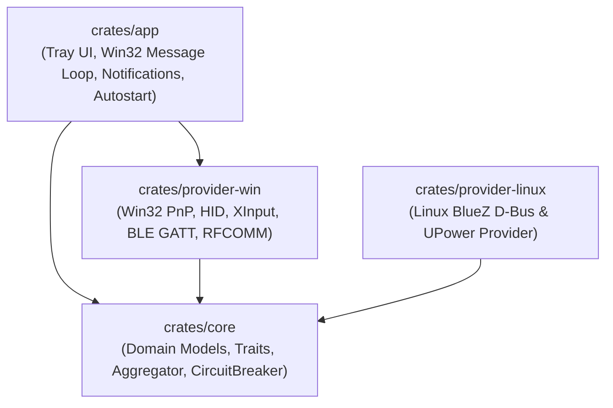
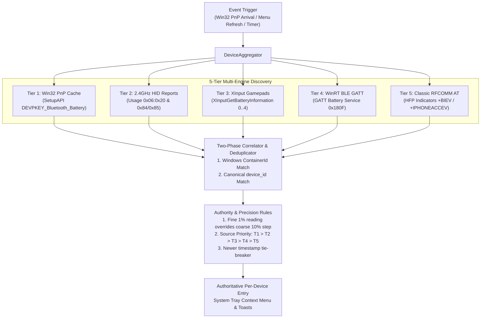
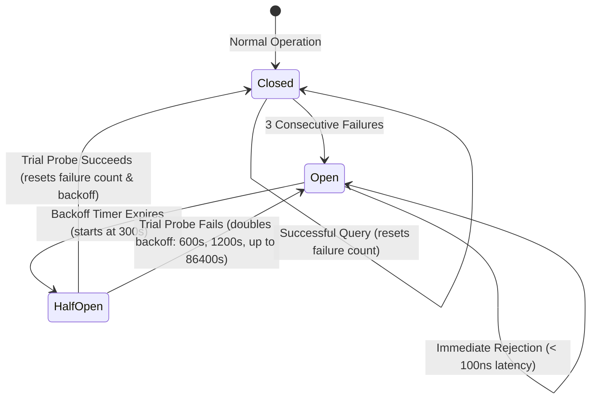

# Atena Battery: Developer & Architecture Guide

This guide details the internal systems engineering architecture, concurrency design, 5-tier battery engine, hardware correlation heuristics, memory safety invariants, build workflows, and instructions for contributing cross-platform extensions (such as `crates/provider-linux`) to **Atena Battery**.

---

## 1. Cargo Workspace Architecture

Atena Battery is organized as a Cargo workspace with strict crate boundary isolation and zero cyclic dependencies:



### Crate Boundaries & Responsibilities

| Crate | Package Name | Responsibility | Dependencies |
| :--- | :--- | :--- | :--- |
| **`crates/core`** | `atena-core` | Zero-OS domain models (`BatteryInfo`, `ConnectionType`, `DeviceCategory`), asynchronous `BatteryProvider` trait, `CircuitBreaker` per-device state machine, `DeviceAggregator`, and `AppConfig`. | `async-trait`, `tokio/sync`, `serde`, `toml` |
| **`crates/provider-win`** | `atena-provider-win` | Windows platform implementations: SetupAPI enumeration (Tier 1), HID battery report reader (Tier 2), XInput controller provider (Tier 3), WinRT BLE GATT provider (Tier 4), RFCOMM HFP AT parser (Tier 5), and Win32 message-only window PnP watcher. | `windows` (official Microsoft crate), `atena-core` |
| **`crates/provider-linux`** | `atena-provider-linux` | Linux platform provider for BlueZ D-Bus (`org.bluez.Battery1`) and UPower. | `atena-core` |
| **`crates/app`** | `atena-app` | Native Windows GUI subsystem (`windows_subsystem = "windows"`), single-threaded Tokio event loop, `tray-icon`, `muda` context menus, Windows Toast notifications, atomic config store, and rolling logs. | `tray-icon`, `muda`, `tracing`, `tracing-appender`, `windows`, `atena-core`, `atena-provider-win` |

---

## 2. Universal 5-Tier Battery Engine & Aggregation Architecture

Atena Battery discovers battery levels using a multi-engine fallback and aggregation pipeline designed to balance query latency, radio power consumption, and multi-protocol hardware compatibility:



### Correlation & Deduplication Algorithm

Many modern gaming peripherals present multiple logical device nodes. For example, a wireless gaming headset may present a Bluetooth audio endpoint alongside a 2.4GHz USB HID dongle reporting battery levels.

`DeviceAggregator::merge()` reconciles these into a single physical entity:
1. **Phase 1: Windows `ContainerId` Match**:
   - Every hardware node in Windows belonging to the same physical device container shares a 128-bit GUID (`DEVPKEY_Device_ContainerId`).
   - If two incoming reports have matching, non-empty Container IDs (case-insensitive and trimmed), they are recognized as the same physical hardware.
2. **Phase 2: Canonical `device_id` Fallback**:
   - For standalone peripherals lacking Container IDs (such as generic Bluetooth accessories or XInput controllers), deduplication matches by normalized `device_id` (MAC address, USB `VID:PID`, or `XInput#N`).
3. **Precision Precedence Rule**:
   - If one provider reports fine 1% precision (e.g. 63% via HID) while another reports coarse 10% stepping (e.g. 60% via OS cache), the fine reading is preferred regardless of tier order.
4. **Source Precedence**:
   $$\text{OsCache (5)} > \text{HidStandard (4)} > \text{XInput (3)} > \text{BleGatt (2)} > \text{Rfcomm (1)}$$

---

## 3. Circuit Breaker State Machine

To prevent radio deadlocks or hung I/O when querying unresponsive peripherals, each device is protected by an isolated `CircuitBreaker`:



- In the `Open` state, queries are rejected immediately without performing any kernel or radio I/O.
- Isolates devices individually: a failure in Device A never impacts queries to Device B.

---

## 4. Win32 Memory Safety & Handle RAII Patterns

Every OS resource in `crates/provider-win` and `crates/app` is wrapped in an RAII `Drop` guard:

```rust
// Example: Safe RAII file handle wrapper in crates/provider-win/src/hid.rs
pub struct SafeFileHandle(pub HANDLE);

impl Drop for SafeFileHandle {
    fn drop(&mut self) {
        if !self.0.is_invalid() {
            // SAFETY: `self.0` is guaranteed to be an open file handle uniquely owned by `SafeFileHandle`.
            unsafe {
                let _ = CloseHandle(self.0);
            }
        }
    }
}
```

### Safety Invariants
1. **Pointer Validity**: All pointers passed to Win32 functions are checked for non-null and memory alignment.
2. **Bounded Buffer Scans**: String scanning from `SP_DEVICE_INTERFACE_DETAIL_DATA_W` is strictly bounded by `buffer_end` to prevent overruns on corrupted driver inputs.
3. **Zero Leaks**: All resources (`HDEVINFO`, `HKEY`, `HDEVNOTIFY`, `PHIDP_PREPARSED_DATA`, and `HANDLE`) release their underlying OS handle when dropped, even during early returns (`?`).

---

## 5. Concurrency & Message Pump Architecture

Atena Battery runs on a single-threaded Tokio runtime (`new_current_thread`) to preserve thread affinity for Win32 GUI message queues:

```text
┌─────────────────────────────────────────────────────────────┐
│ Tokio Single-Threaded Runtime (new_current_thread)          │
│                                                             │
│  loop {                                                     │
│    tokio::select! {                                         │
│      _ = ticker.tick(16ms) => {                             │
│         pump_win32_messages(); // PeekMessageW(PM_REMOVE)   │
│         handle_menu_events();                               │
│      }                                                      │
│      Some(event) = rx.recv() => {                           │
│         handle_pnp_device_change();                         │
│      }                                                      │
│    }                                                        │
│  }                                                          │
└─────────────────────────────────────────────────────────────┘
                               ▲
                               │ Bounded mpsc::channel(64)
                               │
┌──────────────────────────────┴──────────────────────────────┐
│ Win32 Dedicated OS Thread (HWND_MESSAGE)                    │
│  - Registers RegisterDeviceNotificationW for BTH & HID      │
│  - 1.5-second Win32 Debounce Timer (SetTimer)               │
│  - Clean Watchdog Shutdown (WM_SHUTDOWN_WATCHER)            │
│  └──────────────────────────────────────────────────────────┘
```

- **Post-Init Memory Trim**: After initial device discovery, `main.rs` invokes `SetProcessWorkingSetSize(GetCurrentProcess(), usize::MAX, usize::MAX)`, purging temporary startup pages and stabilizing idle RAM at **~2.61 MB**.

---

## 6. Building from Source & Developer Tooling

### Prerequisites
- Windows 10 (version 1809+) or Windows 11 (x64 / ARM64).
- Rust toolchain 1.80+ (`stable-x86_64-pc-windows-msvc`).
- Git for Windows.

### Build and Verification Workflow
```powershell
# 1. Clone repository
git clone -b Rewriting-Rust https://github.com/DevRepoNull/Atena-Battery.git
cd Atena-Battery

# 2. Check compilation across the workspace
cargo check --workspace

# 3. Run all unit, integration, and mock tests (73 tests)
cargo test --workspace

# 4. Enforce zero Clippy warnings
cargo clippy --workspace --all-targets -- -D warnings

# 5. Verify documentation build with zero warnings
cargo doc --no-deps --workspace

# 6. Build the optimized release binary
cargo build --release --workspace
```

The resulting binary `target/release/atena-app.exe` (1.09 MB) is fully self-contained and stripped.

---

## 7. Contributing `crates/provider-linux` Next

`crates/provider-linux` is currently structured as a clean stub implementing `BatteryProvider`. Follow these steps to implement Linux support:

### 1. BlueZ D-Bus Architecture
Linux monitors Bluetooth battery levels via the BlueZ D-Bus interface:
- **Service**: `org.bluez`
- **Interface**: `org.bluez.Battery1`
- **Property**: `Percentage` (byte `0..=100`)
- **Device Object Path Format**: `/org/bluez/hci0/dev_XX_XX_XX_XX_XX_XX`

### 2. Implementation Steps
1. Add `zbus = "4"` to `crates/provider-linux/Cargo.toml`.
2. Connect to the system D-Bus: `let connection = zbus::Connection::system().await?`.
3. In `fetch_snapshot()`:
   - Call `ObjectManager::get_managed_objects()` on `org.bluez`.
   - Filter for objects implementing `org.bluez.Battery1`.
   - Read the `Percentage` property and map the D-Bus object path to a canonical MAC address `XX:XX:XX:XX:XX:XX`.
   - Return a `Vec<BatteryInfo>` with `source = BatterySource::BleGatt` or `BatterySource::OsCache`.
4. In `subscribe_events()`:
   - Subscribe to the `PropertiesChanged` D-Bus signal on `org.freedesktop.DBus.Properties`.
   - When `org.bluez.Battery1.Percentage` changes, construct `DeviceEvent::BatteryUpdated` and dispatch over `Sender<DeviceEvent>`.
5. For 2.4GHz USB dongle mice and keyboards on Linux:
   - Inspect `/sys/class/power_supply/` (e.g. `hidpp_battery_*`) or query UPower over D-Bus (`org.freedesktop.UPower`).
